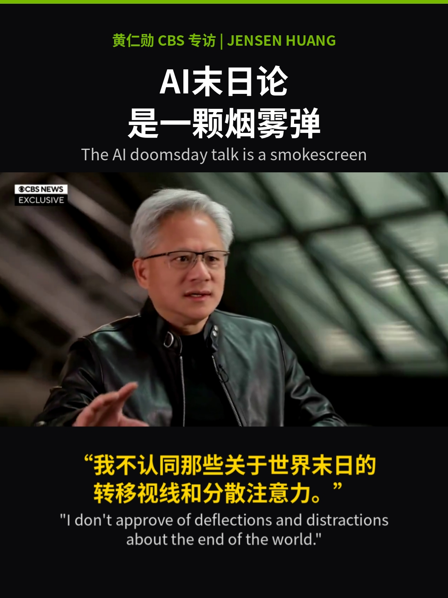
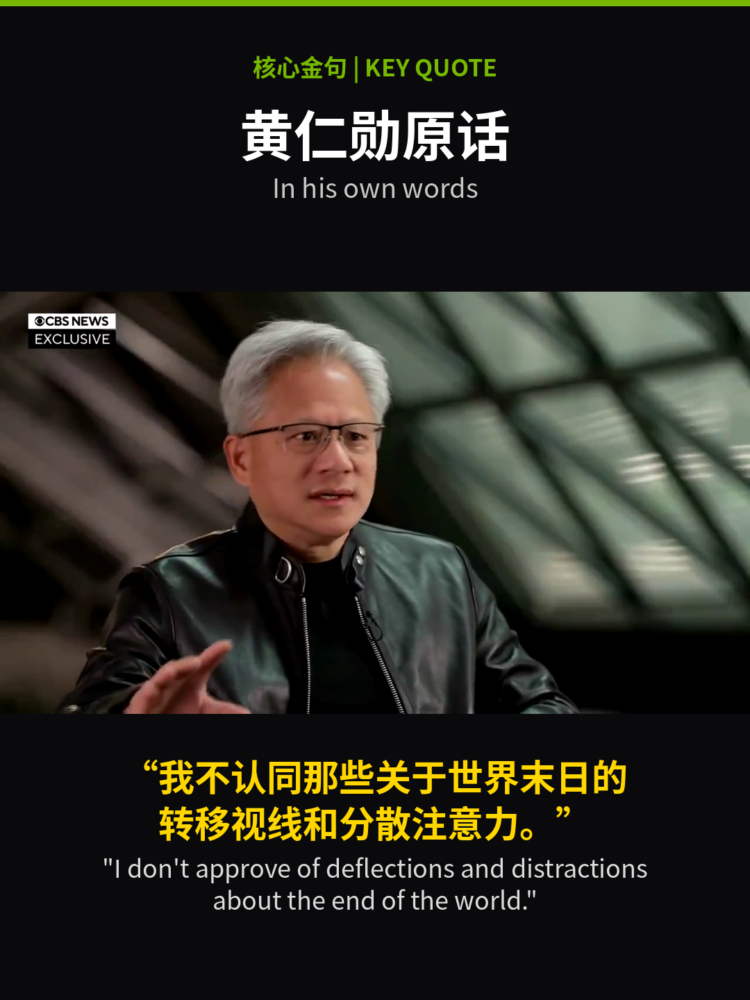
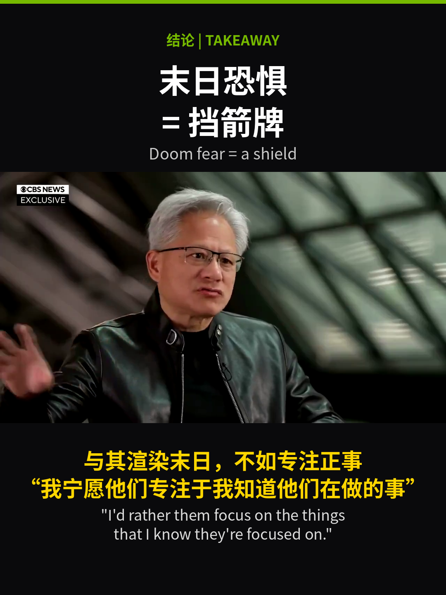
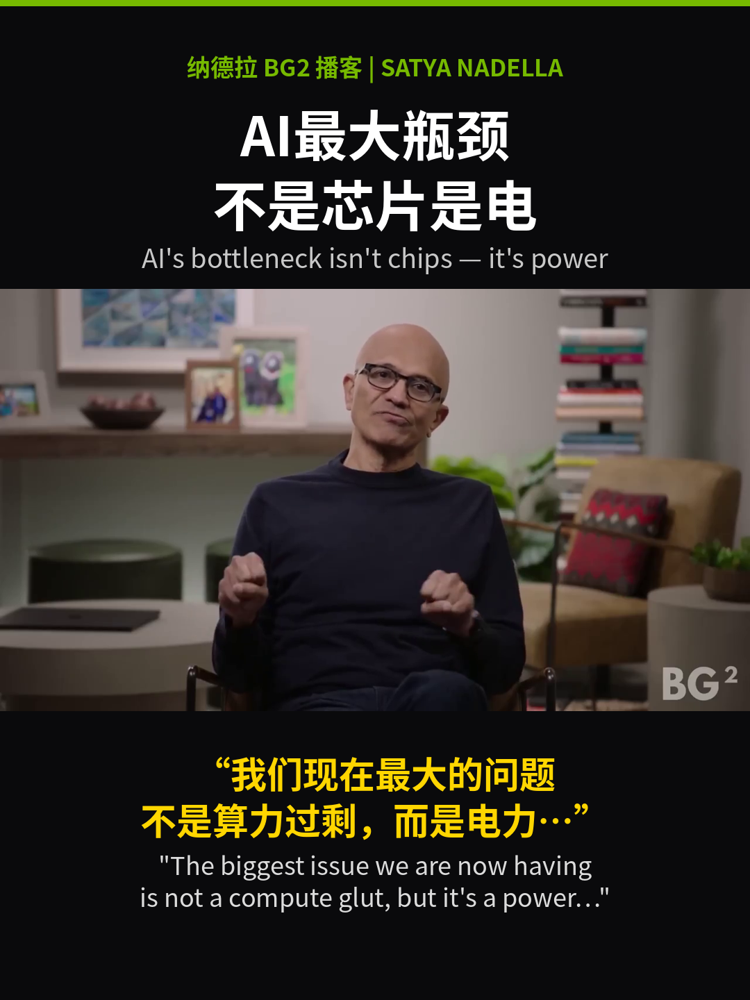
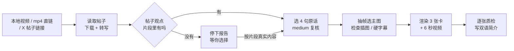

<a name="readme-top"></a>

<div align="center">
  <h1>news-quote-card · 新闻金句双语卡</h1>

  <p><strong>把一段真实采访视频，做成 3 张中英双语金句卡 + 1 段 6 秒双语字幕短视频</strong><br>
  <sub>引语只用原话 · 解读只放标题</sub></p>

  <p>
    <a href="#快速开始"><strong>快速开始</strong></a> &nbsp;·&nbsp;
    <a href="#参考案例">参考案例</a> &nbsp;·&nbsp;
    <a href="#工作流">工作流</a> &nbsp;·&nbsp;
    <a href="#命令行与参数">命令行</a> &nbsp;·&nbsp;
    <a href="#版式规范">版式规范</a> &nbsp;·&nbsp;
    <a href="#常见问题">常见问题</a>
  </p>

  <p>
    
    
    
    
    
    <a href="https://github.com/1433324712/news-quote-card/commits/main"></a>
    <a href="https://github.com/1433324712/news-quote-card/stargazers"></a>
  </p>
</div>

一个给 Agent 用的 Skill（也可以直接跑脚本）：输入一条采访、播客或演讲视频（本地文件、`.mp4` 直链，或 X 等平台的帖子链接），它会先把原声逐字转写，核对帖子里说的观点在片段里到底有没有，再从转写稿里挑出真实原话，配上源视频的真实画面，渲染成一套适合抖音、小红书、X 发布的竖版双语素材，最后附上中英双语简介和话题标签。

它专治两种翻车：**引语不是原话**，和**帖子说的与视频讲的不是一回事**。所以观点、判断、比喻只写在大标题和简介里；黄色引号里的每个字，都必须能回到转写稿的某个时间段逐字对上。

<div align="right"><a href="#readme-top">↑ 回到顶部</a></div>

## 能做什么

- **从视频直接出一整套素材**：一次产出 `01_hook.png`（钩子）、`02_quote.png`（核心金句）、`03_takeaway.png`（结论）三张 1080×1440 金句卡，外加一段与金句卡同为 1080×1440（3:4）、默认 6 秒、保留原声的 `04_video_6s.mp4`，以及中文段 + 英文段 + 话题标签的发帖简介。
- **先核对，再制作**：用 faster-whisper 生成分句与逐词时间戳，逐条比对帖子文案里的观点是否真的出现在片段中。对不上就停下来，告诉你片段实际讲了什么，让你选“换片段”还是“按片段真实内容做”，不会硬凑。
- **双语排版，层级固定**：黑底、顶部一条绿色细线、绿色小标签行“人物 + 采访来源 | ENGLISH NAME”、白色中文大标题、灰色英文标题、中间是原视频画面、下方黄色中文引语 + 浅灰英文引语。中文是主语言，英文保持完整句子，方便海外读者。
- **字幕烧进视频**：短视频顶部与第一张卡相同——绿色人名来源标签 + 中英标题全程显示，中英双语字幕按你给的切点依次切换；默认按原速截取，句子略长时可用 `--fit` 以 `atempo` 轻度调速放进目标时长，音高不变。
- **能去掉原视频的硬字幕**：源视频自带烧录字幕时，卡片和视频都支持 `--crop w:h:x:y`，在缩放前裁掉字幕带，避免“双字幕”。
- **卡片和视频同源**：`make_video.py` 直接从 `render_card.py` 导入字体、颜色和居中排版函数，卡片与视频的视觉永远一致；改设计只改一处。

<div align="right"><a href="#readme-top">↑ 回到顶部</a></div>

## 参考案例

### 主案例：黄仁勋 CBS 专访 · “AI末日论是一颗烟雾弹”

<p align="center">
  <a href="examples/jensen-smokescreen.jpg"></a>
</p>

这张卡把整套设计的规则都体现出来了：

- **顶部**：绿色细线 + 绿色标签行 `黄仁勋 CBS 专访 | JENSEN HUANG`，交代人物与来源。
- **标题（解读）**：“AI末日论 / 是一颗烟雾弹”和 “The AI doomsday talk is a smokescreen” 是我们的判断，所以只出现在标题里。
- **画面（证据）**：黄仁勋说这句话时的真实视频帧，16:9，只做等比缩放，不加滤镜。
- **引语（原话）**：英文原声 “I don't approve of deflections and distractions about the end of the world.”，来自源视频约 90–97 秒；中文是翻译，“deflections and distractions”译作“转移视线和分散注意力”，**没有**升级成“烟雾弹”——这个词只留给标题。

### 案例画廊

点击图片查看 1080×1440 原图。

<table>
  <tr>
    <td width="33%" align="center" valign="top"><strong>01 钩子</strong><br><sub>AI末日论 是一颗烟雾弹</sub><br><a href="examples/jensen-01-hook.png"></a></td>
    <td width="33%" align="center" valign="top"><strong>02 核心金句</strong><br><sub>黄仁勋原话 · In his own words</sub><br><a href="examples/jensen-02-quote.png"></a></td>
    <td width="33%" align="center" valign="top"><strong>03 结论</strong><br><sub>末日恐惧 = 挡箭牌</sub><br><a href="examples/jensen-03-takeaway.png"></a></td>
  </tr>
  <tr>
    <td width="33%" align="center" valign="top"><strong>01 钩子</strong><br><sub>AI最大瓶颈 不是芯片是电</sub><br><a href="examples/nadella-01-hook.png"></a></td>
    <td width="33%" align="center" valign="top"><strong>02 核心金句</strong><br><sub>纳德拉原话 · In his own words</sub><br><a href="examples/nadella-02-quote.png"></a></td>
    <td width="33%" align="center" valign="top"><strong>03 结论</strong><br><sub>AI竞赛 比的是电和机房</sub><br><a href="examples/nadella-03-takeaway.png"></a></td>
  </tr>
</table>

**第一行：黄仁勋 CBS 专访（英文原声，主题跟随模式）。** 用户给的主题是“AI末日论是烟雾弹”，转写确认片段里确实有对应原话，于是按主题写标题。

| 卡 | 源时间 | 原话 | 说明 |
|---|---|---|---|
| 01 钩子 | 7.6–20.5 秒 | “Do you have more faith in the four or five CEOs…” | 记者提问，配记者画面，中文以“记者：”开头 |
| 02 核心金句 | 89.8–96.9 秒 | “I don't approve of deflections and distractions about the end of the world.” | 整套最硬的一句，不删减 |
| 03 结论 | 约 98–103 秒 | “I rather them focus on the things that I know they're focused on.” | 标题“末日恐惧 = 挡箭牌”是解读 |
| 04 视频 | 89.7–96.95 秒 | 同核心金句 | 7.25 秒用 `--fit` 放进 6 秒，速度 1.2083；原片无硬字幕，不裁切 |

**第二行：微软 CEO 纳德拉 BG2 播客（英文原声）。** 帖子列出的几个观点里，“库存芯片插不上电”“不是芯片供应问题，是没有 warm shells”“最大问题是电力”都在片段中找到了出处；帖子里另一句关于其他人的说法在这段 108 秒视频里没有出现，于是不上卡。

| 卡 | 源时间 | 原话 | 说明 |
|---|---|---|---|
| 01 钩子 | 48.26–51.98 秒 | “the biggest issue we are now having is not a compute glut, but it's a power…” | 截断在 power，用 “…” 标出 |
| 02 核心金句 | 59.54–65.34 秒 | “You may actually have a bunch of chips sitting in inventory that I can't plug in. In fact, that is my problem today.” | 不删减 |
| 03 结论 | 65.52–72.02 秒 | “It's not a supply issue of chips. It's actually the fact that I don't have warm shells to plug into.” | warm shells 意译为“通电机房” |
| 04 视频 | 59.40–65.40 秒 | 同核心金句 | 正好 6 秒，原速 1.0，不裁切 |

纳德拉案例里还有一个细节：结论句之后约 72 秒起，转载方插入了一张分屏文字图。按流程对候选视频句做 0.5 秒步长抽帧检查后，视频改用核心金句那一段，避开了插图画面。

<div align="right"><a href="#readme-top">↑ 回到顶部</a></div>

## 一套素材包含什么

| 文件 | 规格 | 内容 | 文字来源 |
|---|---|---|---|
| `01_hook.png` | 1080×1440 PNG | 钩子：抛出冲突或问题 | 标题为解读；引语为原话或记者提问 |
| `02_quote.png` | 1080×1440 PNG | 核心金句：整套最硬的一句 | 标题固定“某某原话 / In his own words” |
| `03_takeaway.png` | 1080×1440 PNG | 结论：给出落点 | 标题为落点；引语为支撑它的原话 |
| `04_video_6s.mp4` | 1080×1440，30 fps，H.264 + AAC | 最“冲”的一句，原声 + 双语烧录字幕 | 逐词时间戳对应的原话 + 译文 |
| 双语简介 | 文本 | 中文 120–200 字 → 英文对应段 → 8–12 个话题标签 | 引号内只用原话，其余为叙述与解读 |

可以按需缩小交付集，例如“只要视频”“只要 3 张图”。

<div align="right"><a href="#readme-top">↑ 回到顶部</a></div>

## 快速开始

**1. 安装 Skill**

仓库根目录就是 Skill 目录（`SKILL.md` 在根目录）。克隆后复制到 Agent 的 Skills 目录：

```bash
git clone https://github.com/1433324712/news-quote-card.git
mkdir -p ~/.codex/skills/news-quote-card
cp -R news-quote-card/SKILL.md news-quote-card/VERSION news-quote-card/requirements.txt \
      news-quote-card/agents news-quote-card/references news-quote-card/scripts \
      ~/.codex/skills/news-quote-card/
```

Claude Code 把 `~/.codex/skills` 换成 `~/.claude/skills`。其他支持 `SKILL.md` 目录格式的 Agent，复制到它文档里规定的 Skills 目录即可。`examples/` 和 `README.md` 只是展示用，不复制也不影响使用。

> [!TIP]
> 升级时先删除旧目录再复制，避免旧版本遗留的文件残留：`rm -rf ~/.codex/skills/news-quote-card`。

**2. 安装依赖**

```bash
python3 -m pip install --break-system-packages -r ~/.codex/skills/news-quote-card/requirements.txt
```

`requirements.txt` 只有三项：`faster-whisper>=1.0`、`numpy>=1.24`、`Pillow>=10.0`。系统 Python 不受 PEP 668 保护时可以去掉 `--break-system-packages`，也可以装进虚拟环境。

另外还需要：

```bash
ffmpeg -version && ffprobe -version          # 必需：解码、抽帧、合成视频
fc-list | grep -i "Noto Sans CJK"            # 必需：Bold 与 Regular 两个字重
python3 -m pip install --break-system-packages yt-dlp   # 仅平台链接（非 .mp4 直链）需要
```

脚本写死使用 `/usr/share/fonts/opentype/noto/NotoSansCJK-Bold.ttc` 与 `NotoSansCJK-Regular.ttc`，Debian / Ubuntu 上安装 `fonts-noto-cjk` 即可得到这两个文件。

**3. 重开一个 Agent 任务，说一句话**

```text
使用 $news-quote-card 把这个 X 链接做成 3 张双语金句卡 + 1 段 6 秒双语字幕视频，主题是“AI 最大的瓶颈是电力”。
```

Agent 会先转写核对，再选句出图；对不上就先停下来问你。

<div align="right"><a href="#readme-top">↑ 回到顶部</a></div>

## 用一句话调用

| 场景 | 对 Agent 说 |
|---|---|
| 给链接 + 主题 | 使用 $news-quote-card，处理这个 X 视频，中英双语 3 图 + 1 个 6 秒视频，主题：AI 末日论是烟雾弹。 |
| 指定一句原话 | 使用 $news-quote-card，用他说 “chips sitting in inventory” 那句做核心金句和视频，先在转写稿里核对。 |
| 源视频有硬字幕 | 使用 $news-quote-card，这段视频底部有中文烧录字幕，裁掉原字幕后再加我们的双语字幕。 |
| 找今天的素材 | 使用 $news-quote-card，在 X 上找一段今天 AI 公司负责人讲话的视频，做成 3+1。 |

> [!TIP]
> `$news-quote-card` 是 Codex 的写法；`agents/openai.yaml` 里给出了显示名“新闻金句双语卡”和默认提示词。其他 Agent 里直接描述需求即可。

<div align="right"><a href="#readme-top">↑ 回到顶部</a></div>

## 工作流



1. **确认任务**：来源、主题、交付集。主题只决定标题框架，不决定引语内容。
2. **获取来源**：X 帖子先用 X 工具读帖子全文（长文读 `note_tweet.text`）和媒体变体，选码率最高的 `video.twimg.com` MP4 直链再下载；其他平台交给 yt-dlp；本地文件直接用。
3. **转写**：`extract.py` 把音频解成 16 kHz 单声道 float32 的 `audio.raw`，以 numpy 数组送入 faster-whisper，输出分句与逐词时间戳。
4. **帖子与片段核对**：逐条观点打勾或标“片段未涉及”。主要观点缺失时停止，附上片段的分段内容概括和候选原话，等你选。
5. **选句与复核**：挑钩子、核心金句、结论、视频共 4 句（视频句可与核心金句相同），对入选时间段用 medium 模型重转写、修正专有名词，写进原话记录表 `quotes.md`。
6. **选帧与裁切**：在每句附近抽帧，挑正脸、睁眼、表情有张力的一帧；视频句按 0.5 秒步长全程检查有没有转载方插入的分屏图或文字卡；有硬字幕时定一个 16:9 裁切框。
7. **渲染**：先渲核心金句卡确认断行和裁切，再渲另外两张，最后渲视频。
8. **质检与交付**：尺寸、时长、音轨、字幕切换、引语逐字对表；写双语简介；把原话与解读分开汇报。

三种任务模式：

- **主题跟随**：你给的主题片段里有出处，标题按主题写，引语找最能支撑它的原话。
- **片段真实内容**：帖子与片段不符，你选择按片段实际内容做，主题由转写稿决定。
- **指定原话**：你指定某一句，仍要在转写稿里逐字核对并找到时间戳；找不到就告诉你，不照抄你的版本上卡。

<div align="right"><a href="#readme-top">↑ 回到顶部</a></div>

## 命令行与参数

不经过 Agent 也可以直接跑。下面的 `<SKILL_DIR>` 换成 Skill 目录的绝对路径；`make_video.py` 会从同目录导入 `render_card.py`，两个文件必须放在一起。

### 1. 下载、转写、抽帧：`extract.py`

```bash
python3 "<SKILL_DIR>/scripts/extract.py" \
  --url "https://video.twimg.com/amplify_video/<id>/vid/avc1/1280x720/<hash>.mp4" \
  --outdir /workspace/raw/<slug> --lang en --model small
```

| 参数 | 默认 | 说明 |
|---|---|---|
| `--url` | — | 去掉查询参数后以 `.mp4` 结尾时用 `curl -sL` 下载；否则调用 `yt-dlp -f mp4/best` |
| `--video` | — | 本地文件，代替 `--url`；脚本不复制它 |
| `--outdir` | 必填 | 输出目录 |
| `--lang` | `en` | 原声语言；中文原声传 `zh` |
| `--model` | `small` | Whisper 模型；中文原声建议 `medium` |
| `--frames` | 每 10 秒 | 逗号分隔的秒数，如 `--frames 58,61,64`；默认从第 2 秒起每 10 秒一帧 |

输出：`video.mp4`（URL 模式）、`audio.raw`、`transcript.txt`（每行 `start-end 文本`）、`words.txt`（每行 `start-end 词`）、`frames/f_<秒>.png`、`contact.jpg`（帧总览）。运行结束会打印全文转写和视频时长。模型以 `compute_type='int8'` 在 CPU 上运行，没有 GPU 也能用。

### 2. 渲染金句卡：`render_card.py`

```bash
python3 "<SKILL_DIR>/scripts/render_card.py" --frame /workspace/raw/<slug>/frames/f_62.png \
  --tag '核心金句 | KEY QUOTE' --headline '纳德拉原话' --headline_en 'In his own words' \
  --quote '“第一行中文引语\n第二行”' --quote_en '"English quote line one\nline two."' \
  --frame-y 420 --out /workspace/deliverables/<slug>/02_quote.png
```

| 参数 | 默认 | 说明 |
|---|---|---|
| `--frame` | 必填 | 源视频的一帧图片 |
| `--tag` | 必填 | 绿色标签行，如 `黄仁勋 CBS 专访 \| JENSEN HUANG` |
| `--headline` | 必填 | 白色中文大标题（解读） |
| `--headline_en` | 必填 | 灰色英文标题 |
| `--quote` | 必填 | 黄色中文引语 |
| `--quote_en` | 必填 | 浅灰英文引语 |
| `--out` | 必填 | 输出 PNG 路径 |
| `--height` | `1440` | 画布高度，宽度固定 1080 |
| `--frame-y` | 居中 | 画面上沿的 y；1440 高时默认 416，核心金句卡惯用 420 |
| `--crop` | 不裁 | `w:h:x:y`，缩放前先裁源帧，用于去掉硬字幕 |

所有文字参数里的 `\n` 会被当作换行。脚本**不会自动换行，也不检测溢出**，断行完全由你控制，必须看图验收。英文引语里有撇号时，shell 中用 `'"'"'` 转义，或改用双引号包住参数。

`render_card.py` 也是一个可导入的模块：`card()` 返回 PIL 图像，`ctext()` 负责居中多行文字，`F / B / R / ACCENT / BG / YEL` 是字体与颜色常量。

### 3. 渲染双语字幕视频：`make_video.py`

```bash
python3 "<SKILL_DIR>/scripts/make_video.py" --video /workspace/raw/<slug>/video.mp4 \
  --start 89.7 --end 96.95 --duration 6 --fit \
  --tag '黄仁勋 CBS 专访 | JENSEN HUANG' \
  --title '中文标题' --title_en 'English title' \
  --subs '2.0|“第一段中文|"Part one' \
  --subs '4.1|第二段|part two' \
  --subs '0|第三段”|part three."' \
  --out /workspace/deliverables/<slug>/04_video_6s.mp4
```

| 参数 | 默认 | 说明 |
|---|---|---|
| `--video` | 必填 | 源视频 |
| `--start` / `--end` | 必填 | 源视频中的起止秒数 |
| `--title` / `--title_en` | 必填 | 全程显示的中英标题 |
| `--subs` | 必填，可重复 | `输出结束时间\|中文\|英文`；最后一段的结束时间被忽略，延续到结尾 |
| `--duration` | `6` | 目标时长（秒） |
| `--fit` | 关 | 开启后速度 = (end − start) / duration，用 `atempo` 调速并保持音高；不开时为原速 1.0 |
| `--crop` | 不裁 | FFmpeg `crop=w:h:x:y`，缩放前应用 |
| `--out` | 必填 | 输出 MP4 路径 |

脚本会打印实际速度；速度不在 0.5–2 之间时直接报错 `atempo out of range`。实际使用中建议不超过 1.25 倍，超过就换短一点的句子或截半句。

**字幕切点是输出时间，不是源时间。** 换算公式：

```text
速度     = (--end − --start) / --duration        # 仅 --fit；否则为 1
输出时间 = (源时间 − --start) / 速度
```

起点一般取句首词开始前约 0.1 秒，终点取句尾词结束后约 0.05 秒，都从 `words.txt` 读。句子比目标时长短时不要用 `--fit` 放慢，而是把起止前后移一点，用自然停顿补足。

编码固定为 libx264（CRF 18，yuv420p）+ AAC 192k，加 `+faststart`，30 fps，可直接上传抖音与 X。

<div align="right"><a href="#readme-top">↑ 回到顶部</a></div>

## 版式规范

所有数值都直接来自 `render_card.py` 与 `make_video.py`。新素材必须与既有版式一致；要改设计，先改 `render_card.py` 里的常量，再整套重出并更新回归基准。

### 颜色与字体

| 元素 | 颜色 | 字体与字号 |
|---|---|---|
| 背景 | `#0A0A0C` | — |
| 顶部细线 | `#76B900` | 卡片与视频均为 8px |
| 标签行 | `#76B900` | Noto Sans CJK SC Bold 34 |
| 中文标题 | 白色 | Bold 78（视频标题 70） |
| 英文标题 | `#C8C8C8` | Regular 38 |
| 中文引语 | `#FFD600` | Bold 52（视频字幕 66） |
| 英文引语 | `#DCDCDC`（视频字幕为白色） | Regular 36（视频字幕 44） |

行高为字号的 1.3 倍，所有文字水平居中。字体取 ttc 的 index=2，即简体中文 SC 字形；换 index 会变成日文或繁体字形，不要改。顶部细线的颜色就是 `ACCENT` 常量，想换成别的品牌色只需改这一处。

### 金句卡（1080×1440）

| 区块 | 位置 |
|---|---|
| 顶部细线 | y = 0–8 |
| 标签行 | 起点 y = 70 |
| 中文标题 | 标签行结束 + 20 |
| 英文标题 | 中文标题结束 + 5 |
| 画面 | 1080×608；默认 y = (H − 608) / 2 = 416；核心金句卡 420 |
| 中文引语 | 画面底部 + 50 |
| 英文引语 | 中文引语结束 + 10 |

### 字幕视频（1080×1440，与金句卡同为 3:4）

| 区块 | 位置 |
|---|---|
| 顶部细线 | y = 0–8（与卡片相同） |
| 标签行 | 起点 y = 70，绿色 Bold 34，格式与卡片相同：`人名 + 播客/采访 | ENGLISH NAME` |
| 中英标题 | 标签行结束 + 20 起中文 Bold 70，再 +5 英文 Regular 38 |
| 画面 | 1080×608，y = 416（与卡片默认 `--frame-y` 相同） |
| 字幕块 | 起点 y = 1074（画面底 + 50，与卡片中文引语间距相同），中文黄色 Bold 66，+10 后英文白色 Regular 44 |

标题模板和每段字幕都先画成透明 PNG，再由 FFmpeg 叠加；同一时刻只显示一段字幕。

### 文字长度建议

| 位置 | 建议上限 |
|---|---|
| 中文标题 | 每行 ≤ 8 字，最多 2 行 |
| 英文标题 | 一行，≤ 45 字符 |
| 卡片中文引语 | 每行 ≤ 16 字，最多 2 行 |
| 卡片英文引语 | 每行 ≤ 50 字符，最多 2 行 |
| 视频中文字幕 | 每段 ≤ 12 字，英文一行；6 秒切 3 段，每段约 1.5–2.5 秒 |

<div align="right"><a href="#readme-top">↑ 回到顶部</a></div>

## 原话规则

这是整个 Skill 最重要的部分。

| 文字类型 | 来源 | 能不能放进引号 |
|---|---|---|
| 帖子文案 | 发帖人的摘要、观点列表 | 不能；只用来定主题、做核对 |
| 源视频硬字幕 | 剪辑方添加，常有删改、意译 | 不能直接用；只作参考 |
| 转写稿 | Whisper 对原声的逐字转写，经复核 | 可以 |

- 引号里的中文或英文必须能回到转写稿某个时间段逐字核对；英文原声时中文是翻译，中文原声时英文是翻译，翻译不能夸大。
- “烟雾弹”“挡箭牌”这类解读只能出现在标题、副标题和简介正文里，不能放进引号，也不能署名为受访者的话。
- 记者提问也可以上卡，但要以“记者：”开头，同样逐字核对。
- 可以删语气词，删减处用 “…” 并在交付里说明；不能把不同时间段的话拼成一句。
- 否定词、数字、专有名词必须试听确认（don't / do、can't / can 一字之差，意思完全相反）。
- 保留“我觉得”“可能”这类限定词，删掉就是夸大。

每个任务在 `/workspace/raw/<slug>/quotes.md` 维护一张原话记录表，渲染前填好。它不是脚本输入，而是审核依据：

| 用途 | 源时间（秒） | 原话（复核后逐字） | 译文 | 删减说明 | 可信度 |
|---|---|---|---|---|---|
| 核心金句 | 59.54–65.34 | You may actually have a bunch of chips sitting in inventory that I can't plug in… | 可能有一堆芯片躺在库存里，我插不上… | 无 | A |

可信度分三级：A（复核一致或已试听，关键词无疑问）、B（个别语气词不确定）、C（否定、数字、专名仍有疑问，不上卡）。核心金句卡和视频句必须是 A 级，钩子卡和结论卡至少 B 级。

**翻译约定**：意译优先但保留锋利度；Q-Day、BTC、OpenAI 等保持英文；人名首次出现中英并列；中文用全角 “”，英文用半角 ""；数字照原话写。

<div align="right"><a href="#readme-top">↑ 回到顶部</a></div>

## 质检清单

出图后先看一张缩略总览（3 张卡 + 视频 3 帧），再逐个打开原尺寸文件。

**卡片**

- 尺寸 1080×1440；区块顺序、颜色、字号与版式规范一致。
- 中文标题 ≤ 2 行，英文标题一行且左右至少留约 40px；引语不贴边。
- 引语与 `quotes.md` 逐字一致，引号成对，中英意思对应。
- 画面没被拉伸（裁切框是 16:9），原视频硬字幕不可见，人物头顶、下巴完整。
- 三张卡主图来自不同时间点，表情与该卡语义相符。

**视频**

```bash
ffprobe -v error -show_entries stream=codec_type,width,height,duration -of compact 04_video_6s.mp4
for t in 1 3 5.5; do ffmpeg -v error -y -ss $t -i 04_video_6s.mp4 -frames:v 1 -vf scale=360:-1 /tmp/s$t.png; done
```

- 分辨率 1080×1440，画面与音轨都在，时长等于目标（原速截取时音轨可能短约 2 ms，允许 ±0.01 秒）。
- 开头、中间、结尾的帧里标题都在；字幕依次切换，没有空白段或重叠段。
- 句首没被吃字、句尾没被截断；字幕与说话的误差不超过约 0.3 秒。
- 全程没有转载方插入的分屏图或文字卡。

发现问题只改对应的一个变量：文字太长就重新断行或换短句；帧不好就前后移动 0.3–1.5 秒重抽；字幕错位就回 `words.txt` 重算切点；句尾被截就把 `--end` 后移 0.1–0.2 秒再算速度。连续三轮仍不理想，就报告限制，不无限微调。

<div align="right"><a href="#readme-top">↑ 回到顶部</a></div>

## 适合与不适合

| 适合 | 不适合 |
|---|---|
| 人物访谈、播客、发布会、演讲片段，有清晰原声 | 无音轨、纯音乐，或多人同时说话听不清的片段 |
| 想做“某某说了什么”的中英双语传播素材 | 希望 Agent 替受访者“总结一句金句”放进引号 |
| 帖子观点能在片段里找到出处 | 帖子说的观点只存在于你没提供的完整版访谈里 |
| 公开可访问或你有权处理的视频 | 需要绕过登录、付费墙、地区限制或 DRM 的内容 |

建议在简介里保留节目来源（如“CBS 专访”），发布前自行确认素材使用权。

<div align="right"><a href="#readme-top">↑ 回到顶部</a></div>

## 常见问题

<details>
<summary><strong>帖子说的和视频里讲的对不上，怎么办？</strong></summary>

<br>

帖子常是完整长访谈的摘要，视频只是其中一段。Skill 会先整段转写，逐条比对：

- **完全对应**：直接选句制作。
- **部分对应**：只用有出处的观点，缺的在交付中写“片段未涉及”。
- **完全不对应**：停止制作，给你一份按时间段的片段内容概括（例如“0–245 秒：公链与交易所竞争；245–761 秒：量子计算对 BTC 的威胁”）和候选原话，让你选择：① 提供含这些观点的片段或完整版；② 按片段真实内容做。

small 模型的中文转写会把专有名词写错，判断“有没有提到”时按语义而不是字面，拿不准的段落用 medium 复核后再下结论。

</details>

<details>
<summary><strong>原视频本身有硬字幕，会和你们的字幕重叠吗？</strong></summary>

<br>

会，所以两个渲染脚本都支持 `--crop w:h:x:y`：

1. 抽 2–4 帧，找到字幕带的上沿。
2. 取一个 16:9 的裁切框把人物框进去、把字幕带留在外面。720p 源的经验值是 `1003:564:40:0`（更安全）或 `1067:600:0:0`（保留更多画面）。
3. 卡片与视频用**同一个**裁切参数。
4. 把一帧放大到 1080×608 检查，确认没有字幕笔画残留。

裁切框必须是 16:9（`h = w × 9 / 16`），否则画面会被拉伸。硬字幕或台标盖住了人物主体、裁完就没有可用画面时，Skill 会停下来说明。

</details>

<details>
<summary><strong>视频里突然插进一张分屏图或截图怎么办？</strong></summary>

<br>

转载剪辑经常在句子中间插入分屏截图（例如另一段采访的文字、AI 回答的截图）。流程要求对视频句按 0.5 秒步长全程抽帧检查，比较画面左右亮度之类的简单指标就能发现切换点。视频句和卡片主图都要避开这些画面，必要时换一句，而不是用 `--crop` 硬裁。纳德拉案例就是这样把视频从结论句换成了核心金句。

</details>

<details>
<summary><strong>中文原声的转写错字很多？</strong></summary>

<br>

整段转写用 small 足够快，但中文专有名词常被写错（Q-Day 写成“QAIS”、BTC 写成“BDC”）。入选的时间段要用 medium 重转写，并加 `initial_prompt` 提示专有名词：

```python
import numpy as np
from faster_whisper import WhisperModel
a = np.fromfile('audio.raw', dtype=np.float32)
m = WhisperModel('medium', compute_type='int8')
s0, s1 = 264, 300
segs, _ = m.transcribe(a[s0*16000:s1*16000], language='zh',
                       word_timestamps=True, initial_prompt='比特币 BTC 量子 Q-Day')
for s in segs:
    print(f'{s.start+s0:.2f}-{s.end+s0:.2f} {s.text}')
```

切片的偏移 `s0` 要加回每个时间戳，否则后面换算全部错位。首次使用 medium 会下载约 1.5 GB 模型，small 约 500 MB，缓存可在任务间复用。

</details>

<details>
<summary><strong>报错 <code>open() got an unexpected keyword argument 'metadata_errors'</code></strong></summary>

<br>

部分 PyAV 版本与 faster-whisper 不匹配。`extract.py` 已先用 FFmpeg 解出 `audio.raw`、以 numpy 数组交给 Whisper 绕开此问题；自写复核代码时照做即可，不必改动 PyAV。

</details>

<details>
<summary><strong>访谈里有记者和嘉宾，会不会把话安错人？</strong></summary>

<br>

Whisper 不区分说话人。Skill 会先在转写稿旁标出“记者 / 受访者”，拿不准的抽帧看画面里是谁在说话；仍确认不了就不用。记者的话可以上钩子卡，但引语以“记者：”开头，配记者画面——黄仁勋案例的 01 卡就是这样。主图默认就是这句话的说话人。

</details>

<details>
<summary><strong>句子比 6 秒长或短怎么办？</strong></summary>

<br>

- **略长**：加 `--fit`，按 (end − start) / duration 轻度加速，建议不超过 1.25 倍。黄仁勋案例 7.25 秒的句子以 1.2083 倍放进 6 秒。
- **太长**：换更短的句子或截半句，而不是继续加速；脚本在速度超出 0.5–2 时会直接报错。
- **略短**：不加 `--fit`，把 `--start` 前移或 `--end` 后移，用前后的自然停顿补足，不要放慢原声。
- **想要别的时长**：改 `--duration`，文件名按需调整。

</details>

<div align="right"><a href="#readme-top">↑ 回到顶部</a></div>

## 目录结构

```text
news-quote-card/
├── SKILL.md                      Agent 指令：规则、命令、质检、停止条件
├── VERSION                       本地版本号（2.1.1）
├── requirements.txt              faster-whisper / numpy / Pillow
├── agents/
│   └── openai.yaml               显示名、简介与默认提示词
├── references/
│   ├── end-to-end-workflow.md    从确认任务到交付的 11 个阶段
│   ├── download-and-transcripts.md  X 链接获取、Whisper 转写与复核
│   ├── visual-style.md           颜色、字号、布局、裁切与字幕节奏
│   └── troubleshooting.md        按“症状 → 先查 → 处理”排错
├── scripts/
│   ├── extract.py                下载 + 转写 + 抽帧
│   ├── render_card.py            1080×1440 双语金句卡（亦可作模块导入）
│   └── make_video.py             1080×1440 双语烧录字幕视频
└── examples/                     README 展示用的案例图
```

推荐目录：原始素材放 `/workspace/raw/<slug>/`，成品放 `/workspace/deliverables/<slug>/`，测试输出只放 `/tmp/`。`<slug>` 用人物或主题的短名，如 `jensen-doom`、`nadella-power`。已交付的成品不会被覆盖。

<div align="right"><a href="#readme-top">↑ 回到顶部</a></div>

## 更多说明

<details>
<summary><strong>回归测试</strong></summary>

<br>

修改脚本、移动目录或升级依赖后，先用黄仁勋案例的钩子卡做一次逐像素回归，输出只写 `/tmp/`：

```bash
cd /tmp && python3 "<SKILL_DIR>/scripts/render_card.py" \
  --frame /workspace/raw/jensen/h13.png --tag '黄仁勋 CBS 专访 | JENSEN HUANG' \
  --headline 'AI末日论\n是一颗烟雾弹' --headline_en 'The AI doomsday talk is a smokescreen' \
  --quote '记者：比起监管，你更信那四五个\n掌控AI的CEO吗？' \
  --quote_en '"Do you have more faith in the four or five CEOs\nwho control this technology than in regulation?"' \
  --out /tmp/nqc_card.png
python3 -c "from PIL import Image,ImageChops as C;a=Image.open('/tmp/nqc_card.png').convert('RGB');b=Image.open('/workspace/deliverables/jensen-doom/01_hook.png').convert('RGB');print(C.difference(a,b).getbbox())"
```

输出 `None` 表示与基准卡逐像素一致。视频回归用同一组参数重新生成到 `/tmp/nqc_video.mp4`，检查时长为 6 秒、打印速度为 1.2083，并抽帧与基准视频目视对比。这套回归依赖本地的基准帧与基准成品，仓库里没有附带；在别的机器上请用自己的第一套成品作为基准。

</details>

<details>
<summary><strong>版本与更新</strong></summary>

<br>

当前版本写在 `VERSION`：**2.1.1**。Skill 不联网检查更新，也不会自动修改自身文件；调整脚本或文档后手动递增版本号，并在交付中说明改动。升级方式是拉取仓库后删除旧目录、重新复制。

v2 相对 v1 的变化：仓库从扁平的四个文件整理为 `scripts/`、`references/`、`agents/` 的 Skill 目录结构；`SKILL.md` 重写为按任务读参考文件的路由式说明；新增帖子与片段核对、原话记录表、可信度分级、插图帧检查等规则。

**2.1.0**：短视频画幅从 1080×1920（9:16）改为与金句卡相同的 **1080×1440（3:4）**；标题、画面、字幕块的纵坐标对齐卡片默认布局（标题 y=70，画面 y=416，字幕 y=1074）。

</details>

**深入文档**

- [完整工作流：从确认任务到交付](references/end-to-end-workflow.md)
- [链接获取、Whisper 转写与原话复核](references/download-and-transcripts.md)
- [视觉规范：颜色、字号、布局、裁切与字幕节奏](references/visual-style.md)
- [排错手册](references/troubleshooting.md)

## 反馈

欢迎在 [Issues](https://github.com/1433324712/news-quote-card/issues) 提问题或建议。排版问题请附上截图和完整命令行。

## 使用说明

本仓库目前没有附带开源许可证文件；如需二次分发或商用，请先联系作者。`examples/` 中的图片只用于展示输出效果，其中的人物画面、节目台标与原话均属于原节目及相关权利人，不因本仓库获得任何授权。使用本 Skill 处理的视频与生成的素材，其发布权限由使用者自行确认。

<div align="right"><a href="#readme-top">↑ 回到顶部</a></div>
